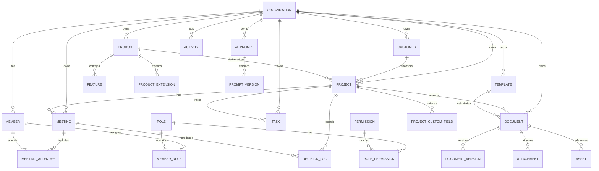

# SHAMOOS Studio Core Data Platform v1.0

## 1. 목적

SHAMOOS Studio의 모든 제품과 고객 프로젝트를 공통 데이터 원칙 위에서 운영하기 위한 Core Data Platform 설계 문서입니다.

이 설계의 핵심 원칙은 다음과 같습니다.

- Product 중심으로 사고한다.
- 재사용 가능한 Core Platform을 먼저 만든다.
- Decision Log를 반드시 남긴다.
- 고객사별, 제품별 확장은 Core를 오염시키지 않는다.
- 운영 데이터와 콘텐츠 데이터는 분리한다.

## 2. 적용 범위

이 플랫폼은 다음 업무를 함께 수용합니다.

- HunaStay
- TW-LMS
- EolmaAI
- SAILog
- SHAMOOS Studio 내부 운영
- 고객 프로젝트
- 제안서, 회의, 계약, 산출물 관리
- AI Prompt, Template, Knowledge 운영

## 3. 설계 원칙

### 3.1 Product First

모든 업무는 Product를 중심 축으로 한다.

- 고객 프로젝트도 결국 하나의 Product 또는 Product-backed Project로 본다.
- 회의, 과제, 문서, 의사결정은 Product 또는 Project에 연결된다.

### 3.2 Core and Extensions

Core에는 모든 제품이 공통으로 쓰는 엔터티만 둔다.

- Organization
- Member
- Role, Permission
- Customer
- Product
- Project
- Meeting
- Decision Log
- Task
- Document
- Asset
- Template
- AI Prompt
- Activity

제품별 차별화 데이터는 Extension Schema로 분리한다.

### 3.3 Decision Log First

모든 중요한 구조 변경은 Decision Log에 남긴다.

- 왜 결정했는지
- 어떤 대안이 있었는지
- 누가 승인했는지
- 언제 적용했는지

### 3.4 Auditability

주요 업무 객체는 생성, 수정, 삭제 이력을 남길 수 있어야 한다.

### 3.5 Notion Friendly

설계는 Notion CMS와 쉽게 동기화될 수 있어야 한다.

## 4. 데이터 계층

### 4.1 Core Layer

공통 운영 데이터.

### 4.2 Product Layer

제품별 공통 확장 데이터.

### 4.3 Domain Extension Layer

HunaStay, TW-LMS, EolmaAI/SAILog 같은 제품 전용 데이터.

### 4.4 Content Layer

문서, 템플릿, 지식, 첨부파일, AI 프롬프트.

## 5. 주요 엔터티 개요

### Organization

한 작업 공간 또는 회사 단위.

### Member

조직에 속한 사용자.

### Role / Permission

권한 제어를 위한 구조.

### Customer

고객사 또는 외부 이해관계자.

### Product

서비스 또는 제품 단위.

### Project

실행 단위. 제품, 고객, 기간, 범위를 함께 가진다.

### Meeting

회의 기록. 의사결정과 후속 작업의 출발점이다.

### Decision Log

중요한 선택과 근거를 남기는 시스템 기록.

### Task

실행 가능한 업무 단위.

### Document

PRD, 제안서, 회의록, 가이드, 정책 문서.

### Asset

이미지, 파일, 링크, 외부 리소스.

### Template

문서와 운영 작업의 반복 가능한 형식.

### AI Prompt

재사용 가능한 프롬프트 자산.

### Activity

시스템 이벤트와 사용자 활동 추적.

## 6. Mermaid ERD



## 7. 관계 설명

### Organization -> Member

하나의 조직은 여러 멤버를 가진다.

### Organization -> Product / Customer / Project

모든 핵심 데이터는 Organization 범위 안에서 분리된다.

### Customer -> Project

고객은 하나 이상의 프로젝트를 갖는다.

### Product -> Project

프로젝트는 특정 제품과 연결될 수 있다.

### Project -> Task / Meeting / Document / Decision Log

프로젝트는 실제 실행 맥락의 중심이다.

### Meeting -> Decision Log

회의는 의사결정의 입력이며, 결정은 별도 기록으로 남긴다.

### Document -> Version / Attachment / Asset

문서는 버전과 첨부, 참조 자산을 가진다.

### Template -> Document

템플릿은 문서 생성의 시작점이다.

### AI Prompt -> Prompt Version

프롬프트는 반드시 버전 관리한다.

## 8. Notion CMS 연동 원칙

Core 플랫폼은 Notion에서 다음 용도로 운영할 수 있다.

- 문서 관리
- 회의록 관리
- 결정 로그
- 템플릿 관리
- 지식베이스
- 영업/제안 관리

정형 데이터는 PostgreSQL에 두고, 문서성 데이터는 Notion과 양방향 동기화하는 방식을 권장한다.

## 9. API 설계 원칙

- REST 우선
- 모든 요청은 `organizationId` 또는 세션 컨텍스트를 가진다.
- 목록은 페이지네이션을 기본으로 한다.
- 생성/수정에는 `idempotencyKey`를 지원할 수 있다.
- 삭제는 논리 삭제를 우선한다.
- Decision Log 생성은 선택이 아니라 기본 동작이어야 한다.

## 10. 구현 순서

1. Core schema
2. Authentication and RLS
3. Organization / Member / Role
4. Product / Customer / Project
5. Task / Meeting / Decision Log
6. Document / Template / AI Prompt
7. Product extension schemas
8. Notion sync
9. API layer
10. Analytics and activity log

## 11. 폴더 구조 제안

```text
shamoos-core-platform/
  docs/
    shamoos-core-platform-v1.0.md
    erd/
      shamoos-core-erd.mmd
    api/
      api-rules.md
    notion/
      notion-cms-mapping.md
    checklist/
      migration-implementation-checklist.md
  sql/
    supabase-initial-schema.sql
  prisma/
    schema.prisma
  extensions/
    huna-stay-extension.md
    tw-lms-extension.md
    eolmaai-sailog-extension.md
```

## 12. Notes

이 문서는 SHAMOOS Studio의 공통 데이터 철학을 정리한 기준 문서이며, 실제 제품별 구현은 extension layer에서 별도 관리한다.
